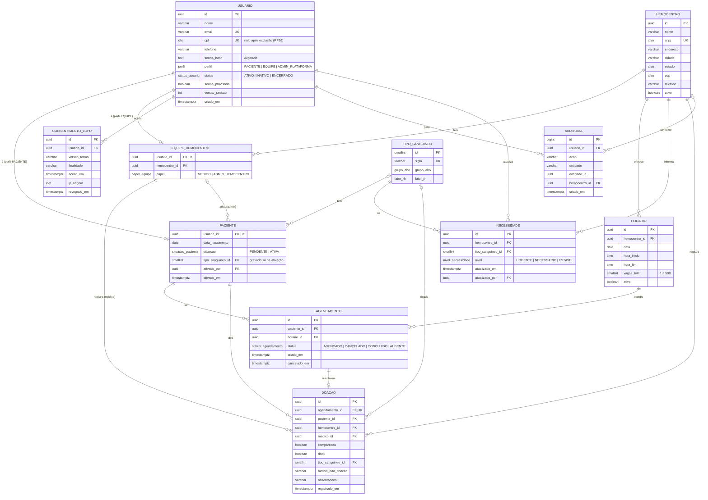

# Diagrama Entidade-Relacionamento (DER)

Modelo de dados do Hemobridge após a refatoração para o agendamento de doação. A fonte da verdade é [`backend/prisma/schema.prisma`](../backend/prisma/schema.prisma); regras que o Prisma não expressa (CHECKs e índices únicos parciais) estão nas migrations.

## Regras no banco

| Regra | Onde |
|---|---|
| Um nível por hemocentro e tipo | `UNIQUE (hemocentro_id, tipo_sanguineo_id)` em `necessidade` |
| Um horário por hemocentro, dia e hora de início | `UNIQUE (hemocentro_id, data, hora_inicio)` em `horario` |
| Um agendamento ativo por paciente e horário (RF09) | índice único parcial `(paciente_id, horario_id) WHERE status = 'AGENDADO'` |
| Uma doação por agendamento | `UNIQUE (agendamento_id)` em `doacao` |
| Vagas entre 1 e 500; fim depois do início | CHECKs em `horario` |
| Só doa quem compareceu; quem compareceu e não doou tem motivo | CHECKs em `doacao` |
| Conta ATIVA tem tipo sanguíneo e quem ativou | CHECK em `paciente` |
| Sem overbooking (RNF06) | `SELECT … FOR UPDATE` na linha de `horario` durante o agendamento (aplicação) |

## Índices de consulta

`horario (hemocentro_id, data)`, `agendamento (horario_id, status)`, `agendamento (paciente_id, status)`, `doacao (paciente_id, registrado_em)`, `doacao (hemocentro_id, registrado_em)`, `auditoria (usuario_id, criado_em)` e `auditoria (entidade, entidade_id)`.
