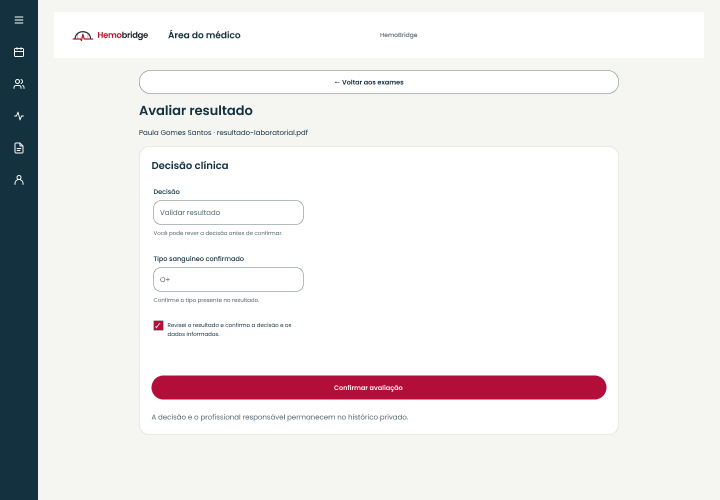

# Médico

[Voltar ao índice do manual](README.md)

*Aplicação web executada em 21/10/2026. Fonte: HemoBridge; conta e instituição sintéticas de testes.*

No site, use **Minha agenda**, **Atendimento** e **Exames** na área profissional. No aplicativo, os destinos inferiores são **Agenda**, **Comunidade**, **Exames** e **Perfil**. O cadastro e os vínculos institucionais determinam o acesso aos registros.

## Selecionar a instituição de trabalho

1. Abra **Minha agenda** ou **Agenda**.
2. Confira a seção **Instituição de trabalho** no site ou o seletor **Instituição** no app.
3. Escolha a instituição em que realizará o atendimento.
4. Aguarde o carregamento da agenda e confirme o nome da instituição antes de registrar ações.

Quem trabalha em mais de um hospital deve trocar a instituição antes de consultar ou publicar horários naquele contexto. Se não houver vínculo ativo, a tela informa a ausência de instituição; uma conta não recebe acesso a outros hospitais apenas por alterar a seleção.

## Publicar e consultar horários

1. Na instituição correta, abra **Publicar horário**.
2. Informe início, fim e o **Link de teleconsulta** HTTPS solicitado pelo formulário.
3. Revise os dados e confirme a publicação.
4. Confira o horário na lista.
5. Use **Próximos** para os horários atuais/futuros e **Histórico** para os encerrados. Utilize as ações de página anterior ou seguinte quando disponíveis.

Em caso de sobreposição, intervalo inválido ou vínculo indisponível, leia a mensagem e corrija o registro. Não publique outra vaga sem conferir se a primeira foi salva.

## Registrar atendimento e solicitar exames

1. No site, abra **Atendimento**. No app, abra a consulta atribuída pela agenda.
2. Confira paciente, instituição, data e situação.
3. Abra a consulta externa quando o link estiver disponível.
4. Após o horário de início, registre o desfecho correspondente: **Registrar como realizado** ou **Registrar ausência**.
5. Para solicitar exames, informe os nomes dos exames e as orientações. No site, digite um exame por linha.
6. Revise e escolha **Solicitar exames**. Confira a confirmação.
7. Para revisar um atendimento realizado, use **Histórico** e **Retomar atendimento**, quando disponível.

As ações só aparecem ou ficam habilitadas quando o atendimento e a autorização permitem. Os registros devem refletir o atendimento conduzido pelo profissional responsável.

## Avaliar um resultado

1. Abra **Exames** e localize a solicitação de um atendimento autorizado.
2. Abra o arquivo privado e confira seu conteúdo.
3. Escolha **Avaliar resultado**.
4. Selecione explicitamente **Validar resultado** ou **Reprovar e solicitar novo envio**.
5. Para validar, informe o **Tipo sanguíneo confirmado** conforme o resultado e a avaliação profissional. Para novo envio, escreva o motivo e a orientação solicitados.
6. Revise a decisão e marque a confirmação de conferência.
7. Escolha **Confirmar avaliação** e aguarde o resultado.

*Figura de referência do protótipo aprovado. Ilustra uma decisão já selecionada pelo profissional, sem representar avaliação clínica executada no app ou no site.*

A avaliação de um resultado não substitui a conferência dos demais exames e das regras da jornada. Se houver conflito, resultado mais recente ou perda de autorização, atualize a lista e revise a situação antes de continuar. Não use a Comunidade para receber exames ou discutir casos identificáveis.

## Comunidade e perfil

Em **Comunidade**, publique orientações gerais relacionadas a saúde e doação, com as normas descritas no [capítulo comum](README.md#comunidade-publicar-comentar-e-acompanhar). O selo **Perfil Verificado** depende da verificação cadastrada.

Em **Perfil**, confira nome, e-mail e o perfil de acesso. No site, estão disponíveis **Alterar senha**, **Privacidade e direitos** e **Termos de uso**. No app, use **Ver apresentação** para rever as boas-vindas e **Sair** para encerrar a sessão. Para atualizar cadastro profissional ou vínculo que não é editável nessa tela, utilize o procedimento autorizado pela instituição.
