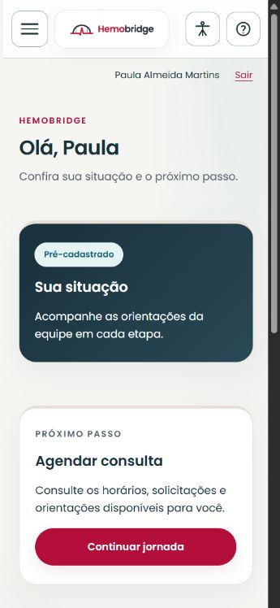
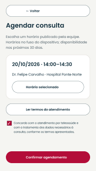
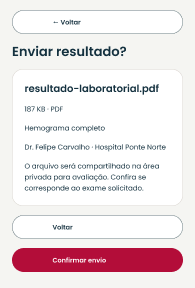
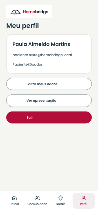

# Paciente/Doador

[Voltar ao índice do manual](README.md)

*Aplicação web executada em 360 px, 21/10/2026. Fonte: HemoBridge; conta sintética de testes. A imagem mostra a página web, não o app Flutter.*

No site, use **Meu painel**, **Locais** e **Perfil** na navegação principal. Consultas, exames e notificações também aparecem como atalhos do painel. No aplicativo, os quatro destinos inferiores são **Painel**, **Comunidade**, **Locais** e **Perfil**.

## Acompanhar sua situação

1. Abra **Meu painel** no site ou **Painel** no app.
2. Leia **Sua situação** e o cartão **Próximo passo**.
3. Use **Continuar jornada** no site ou os botões do painel no app para abrir consultas ou exames.
4. Confira as orientações da equipe antes de prosseguir.

| Situação | O que fazer |
| --- | --- |
| Pré-cadastrado | Verificar as orientações e os horários disponíveis para consulta |
| Consulta agendada | Conferir data, profissional, instituição e acesso à consulta |
| Aguardando exame | Abrir a solicitação, ler as orientações e enviar o resultado pedido |
| Em análise | Aguardar a avaliação e acompanhar eventuais orientações de novo envio |
| Aprovado | Consultar a jornada disponível e confirmar o atendimento presencial com a instituição |
| Reprovado | Ler a orientação ou o motivo apresentado e seguir as instruções da equipe |

O tipo sanguíneo validado aparece para consulta. O paciente não o altera pelo perfil.

## Agendar consulta

1. Abra **Agendar consulta** no painel.
2. Escolha um horário publicado e confira profissional e instituição.
3. Leia os termos do atendimento por telessaúde e confirme o aceite solicitado.
4. Revise a escolha e use **Confirmar agendamento**.
5. Aguarde a confirmação e confira o registro em **Minhas consultas**.

Se o horário tiver sido ocupado, atualize as opções e escolha novamente. Se não houver horários, consulte mais tarde; a tela informa que não há disponibilidade.

*Figura de referência do protótipo aprovado. Representa o estado de confirmação; não registra um agendamento executado no aplicativo.*

## Consultar, cancelar ou reagendar

1. Abra **Minhas consultas**.
2. Confira data, médico, instituição e situação do atendimento.
3. Use **Abrir consulta** quando o link da sala estiver disponível. O atendimento abre no serviço externo configurado pela equipe.
4. Para alterar uma reserva, abra as opções de cancelamento ou reagendamento, escolha o novo horário quando necessário e confirme a ação.
5. Aguarde a mensagem e confira se a lista mostra a alteração.

O sistema pode recusar a alteração por antecedência insuficiente, situação do atendimento ou conflito de horário. Leia a mensagem e consulte a equipe quando precisar de orientação. Uma ausência registrada ou um cancelamento altera a jornada apresentada no painel.

## Enviar e acompanhar exames

1. Abra **Meus exames** e selecione a solicitação correspondente.
2. Confira o profissional, os exames solicitados e as orientações.
3. Escolha um arquivo PDF, JPG ou PNG de até **5 MB**. Confira se ele é o resultado pedido.
4. No site, use **Enviar resultado**. No app, revise o resumo e escolha **Confirmar envio**.
5. Aguarde a confirmação de envio para análise. O envio não significa validação do resultado.
6. Consulte o histórico. Quando houver pedido de novo envio, leia o motivo e envie o arquivo correto pela mesma área privada.
7. Para visualizar um arquivo já enviado, use o nome do arquivo no site ou **Abrir arquivo privado** no app.

*Figura de referência do protótipo. Os dados representados pertencem ao conjunto de testes do projeto.*

Se o arquivo exceder o limite ou tiver formato inválido, selecione outro. Se houver falha de conexão, confira o histórico antes de tentar de novo. Se o leitor falhar, use **Tentar novamente** ou retorne à lista; não transfira o resultado para uma publicação pública.

## Encontrar locais

### Busca manual no site e no app

1. Abra **Locais**.
2. Selecione o Estado, aguarde os municípios e escolha a cidade.
3. Escolha o serviço: **Doação de sangue**, **Exame de sangue** ou **Exames adicionais**.
4. Use a busca no Google Maps e confira o endereço e os canais da unidade.
5. Confirme com a unidade se realiza o serviço, seus horários e as orientações antes de se deslocar.

No site, o mapa de referência pode ser centralizado com **Ver minha região**, mediante permissão do navegador. A página também oferece acesso à lista de hemocentros do Ministério da Saúde.

### Localização pelo aplicativo

1. Toque em **Usar minha localização** quando desejar usar o GPS.
2. Escolha a permissão no aviso do Android ou iOS.
3. Aguarde a mensagem de localização obtida e escolha o serviço.
4. Toque em **Buscar no Google Maps** para abrir a busca externa.
5. Use **Limpar localização** quando quiser voltar à escolha manual.

A captura é pontual, iniciada pelo botão; o app não acompanha seu deslocamento continuamente. A posição permanece na memória dessa tela. A região aproximada é enviada ao Maps quando você abre a busca. Se o GPS estiver desligado, a permissão for negada ou ocorrer demora, use Estado/Município. **Abrir configurações** aparece nos cenários em que é necessário ajustar a permissão ou o serviço do aparelho.

O mapa de referência e uma busca externa não confirmam vagas, exames disponíveis ou serviço de coleta. Essas informações precisam ser conferidas diretamente com a unidade.

## Notificações

No site, abra **Notificações** pelo painel ou por **Mais opções**. Leia a lista e use a ação de marcar como lida; navegue entre páginas quando houver mais registros. Mensagens por e-mail podem informar a existência de um aviso, mas detalhes privados devem ser consultados após entrar na conta.

Na versão atual do aplicativo, a barra inferior não contém uma página própria de notificações. Consulte-as pelo site enquanto essa área não estiver disponível no app.

## Perfil e segurança

1. Abra **Perfil**. No app, toque em **Editar meus dados**.
2. Atualize telefone, peso, Estado e Município conforme os campos autorizados.
3. Confira os dados e use **Salvar alterações** ou a confirmação equivalente no formulário do app.
4. Para alterar a senha, use **Alterar senha** na área de segurança do site.
5. Para sair, escolha **Sair** e aguarde o retorno à tela de entrada.

*Figura de referência do protótipo aprovado. O nome e o endereço exibidos são registros de teste.*

No site, **Meu perfil e privacidade → Encerramento da conta** permite enviar uma solicitação com a senha atual. Aguarde a confirmação e acompanhe o atendimento pelo canal de privacidade publicado. O pedido não promete remoção imediata de todos os registros; a plataforma informa o tratamento aplicável e as obrigações de guarda. Na versão atual do app, alteração de senha e envio desse pedido são feitos pelo site.

## Participar da Comunidade

Use o capítulo [Comunidade](README.md#comunidade-publicar-comentar-e-acompanhar). Preserve os resultados e as informações do seu atendimento nas áreas privadas.
