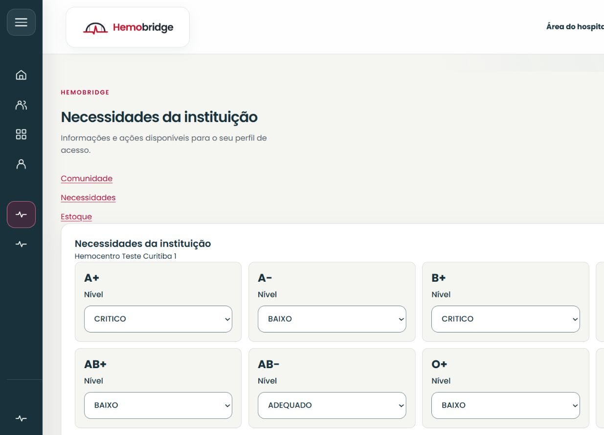
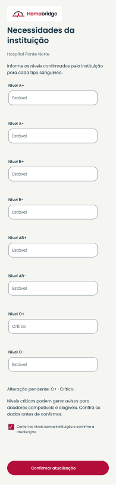
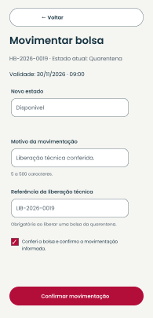

# Representante de Hospital

[Voltar ao índice do manual](README.md)

*Aplicação web executada em 21/10/2026. Fonte: HemoBridge; níveis e instituição da carga de testes, sem correspondência com estoque real.*

No site, a área do hospital contém **Necessidades** e **Estoque**. No aplicativo, os quatro destinos inferiores são **Necessidades**, **Comunidade**, **Estoque** e **Perfil**. Confira sempre a instituição vinculada à conta.

## Atualizar necessidades de sangue

1. Abra **Necessidades**.
2. Confira o nome da instituição e os oito tipos sanguíneos.
3. Altere somente os níveis cuja informação foi conferida pela instituição: **Crítico**, **Baixo**, **Estável** ou **Adequado**.
4. Revise os valores alterados. No app, confirme também a conferência solicitada pelo formulário.
5. Escolha **Confirmar atualização** e aguarde a mensagem de sucesso.

**Não informado** indica ausência de informação registrada. Não deve ser interpretado como nível adequado. Uma alteração para nível crítico pode gerar avisos aos doadores compatíveis e elegíveis, conforme os controles de envio da plataforma.

*Figura de referência do protótipo aprovado. A necessidade apresentada é ilustrativa; só confirme os níveis realmente informados pela instituição.*

## Publicar um aviso institucional

1. Abra **Comunidade → Criar publicação**.
2. Escreva um título claro e as informações gerais do aviso.
3. Em **Assunto**, escolha **Aviso institucional**.
4. Quando cabível à instituição verificada, selecione **Aviso crítico ou urgência de estoque da instituição** e informe o término solicitado.
5. Confira o conteúdo, leia as normas e confirme o aceite.
6. Escolha **Publicar** e confira o aviso na lista.

Os avisos críticos ativos e autorizados aparecem na área prioritária. O aviso público é diferente da atualização dos níveis de necessidade: confirme os dados em **Necessidades** e publique somente as informações institucionais apropriadas. Não inclua resultados de exames, identificação de doadores ou casos clínicos individuais.

## Registrar uma bolsa no estoque

1. Abra **Estoque** e confira os registros existentes.
2. Em **Registrar bolsa**, informe código rastreável, hemocomponente, tipo sanguíneo, data/hora da coleta e validade.
3. Revise os campos e use **Registrar em quarentena**.
4. Aguarde a confirmação e confira a bolsa na lista com a situação **Quarentena**.

Registrar uma bolsa no estoque não equivale a registrar o evento completo de doação de uma pessoa. Siga o procedimento institucional aplicável a cada registro.

## Movimentar uma bolsa

1. Na bolsa correta, abra **Movimentar bolsa**.
2. Confira código, tipo, validade e estado atual.
3. Escolha um dos próximos estados oferecidos.
4. Informe o motivo. Para liberar uma bolsa de quarentena, informe a referência da liberação técnica exigida.
5. Revise os dados e confirme a movimentação.
6. Aguarde a atualização da lista. Se o estado tiver sido alterado por outra pessoa, recarregue e confira o registro antes de tentar de novo.

*Figura de referência do protótipo aprovado. A movimentação deve corresponder ao procedimento realmente autorizado pela instituição.*

Os próximos estados dependem da situação atual. Por exemplo, uma bolsa em quarentena pode ser liberada ou descartada; uma disponível pode ser reservada ou descartada; uma reservada pode voltar a disponível, ser utilizada ou descartada. Registros utilizados ou descartados não apresentam nova movimentação nessa interface.

## Perfil e limites desta versão

Em **Perfil**, confira a identificação da conta e encerre a sessão em **Sair**. A Comunidade está disponível para publicação, comentários e denúncias conforme as [normas de participação](README.md#comunidade-publicar-comentar-e-acompanhar).

O menu desta versão não oferece telas para cadastrar médicos, registrar a doação individual por CPF, consultar gráficos de doações ou exportar relatórios. O [registro de revisão](revisao-e-evidencias.md) identifica essas diferenças entre os serviços existentes e a navegação apresentada, para que a equipe as confira antes da apresentação final.
