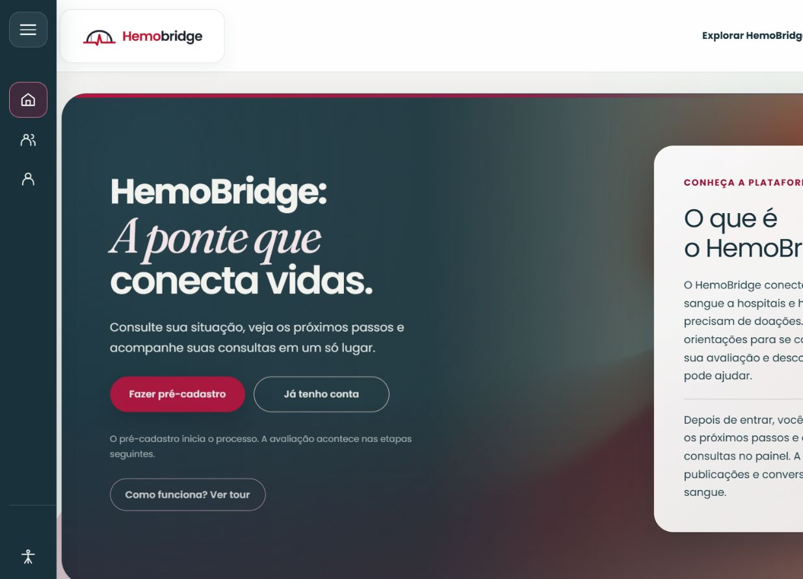

# Visitante

[Voltar ao índice do manual](README.md)

*Aplicação web executada no notebook em 21/10/2026. Fonte: HemoBridge, ambiente de testes.*

## Conhecer a plataforma

1. Abra o site e leia a apresentação do HemoBridge no **Início**.
2. Use **Comunidade** para consultar publicações e comentários públicos.
3. Abra **Como funciona** para ler a proposta e as etapas da plataforma, sem abrir um modal.
4. Consulte **Privacidade**, **Termos de uso** e **Normas da comunidade** no rodapé.

Para publicar, comentar ou curtir, entre na conta e conclua a apresentação quando ela estiver pendente. O app também abre no Início do visitante, com explicação da plataforma, Comunidade pública, cadastro e acesso à conta.

## Fazer pré-cadastro

1. No site, escolha **Fazer pré-cadastro**. No app, use a opção de criar conta na tela de entrada.
2. Informe os dados solicitados: nome, CPF, e-mail, telefone, data de nascimento, sexo e peso.
3. Em **Estado**, escolha a UF. Aguarde o carregamento e selecione o **Município**. Ao trocar o Estado, selecione o Município novamente.
4. Crie a senha e repita-a no campo de confirmação. Siga os requisitos exibidos pelo formulário.
5. Abra e leia o termo de consentimento vigente. Confirme o aceite e os avisos apresentados, quando aplicáveis ao seu cadastro.
6. Revise os dados e confirme o pré-cadastro. Aguarde a mensagem de conclusão.
7. Entre com o e-mail e a senha cadastrados. Leia primeiro a introdução à plataforma e, quando estiver pronto, escolha **Entendi o HemoBridge. Conhecer minha jornada**. Conclua as etapas para liberar as funções da conta.

O pré-cadastro cria uma conta de Paciente/Doador. Perfis profissionais são concedidos pelo cadastro e pelos vínculos autorizados; não são escolhidos no formulário público. A conclusão do cadastro não significa aprovação clínica para doar.

## Entrar e recuperar a senha

1. Escolha **Entrar** ou **Já tenho conta**.
2. Informe e-mail e senha, confira os dados e confirme o acesso.
3. Se esqueceu a senha, abra **Recuperar senha** e informe o e-mail cadastrado.
4. Consulte a mensagem recebida e abra o link de redefinição. Crie e confirme uma nova senha.
5. Se o link expirou ou já foi utilizado, solicite outro e use a mensagem mais recente.

O sistema pode limitar tentativas repetidas de acesso. Siga a mensagem exibida e aguarde antes de tentar novamente. Não compartilhe o link de recuperação.

## Quando o cadastro não conclui

Revise os campos destacados e a conexão. E-mail e CPF não podem ser usados em cadastros repetidos. Se você já possui conta, retorne a **Entrar** ou utilize a recuperação de senha. Se Estado/Município ou o termo não carregarem, tente novamente antes de enviar o formulário.

## Próximo passo

Depois de entrar, siga o capítulo [Paciente/Doador](paciente-doador.md). Os horários, solicitações e orientações exibidos no painel dependem dos registros da equipe responsável pelo atendimento.
