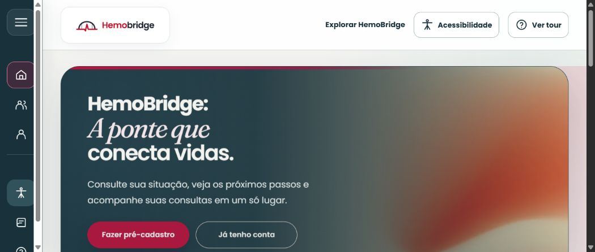
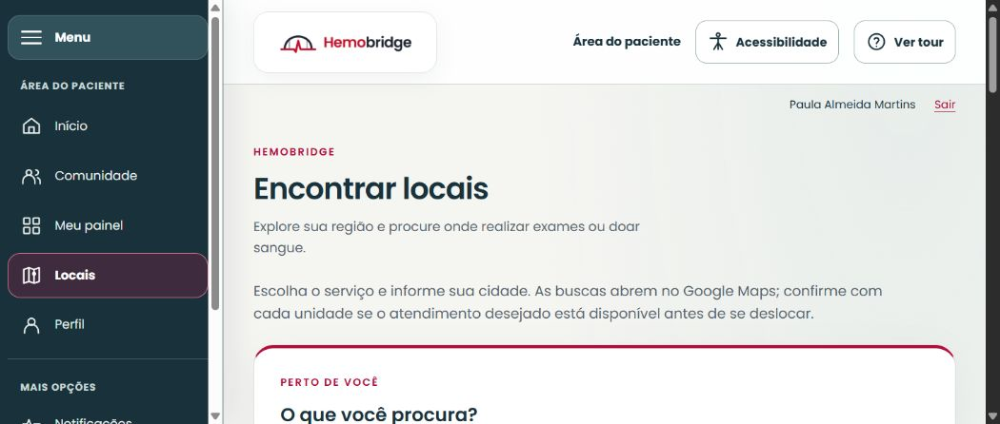

# Consolidação das seções 10, 11 e 12 — 21 e 22/10/2026

Material para a pessoa responsável pela edição do TCC incorporar ao documento final. O PDF de referência e os arquivos sincronizados não foram alterados. A numeração de figuras, a paginação e a formatação devem ser ajustadas na versão única do trabalho, conforme as normas adotadas pela UTP.

## 10. Interfaces e implementação

O HemoBridge reúne uma aplicação web em React e TypeScript, uma API em NestJS e Prisma, persistência em PostgreSQL/PostGIS e um aplicativo Flutter/Dart. Os protótipos estão organizados no arquivo oficial do Figma em Web desktop, Web mobile e Aplicativo, com agrupamentos por perfil e biblioteca de componentes. A equipe aprovou visualmente as telas, conforme informação da responsável em 21 de outubro de 2026. A conferência dos critérios específicos de cada tarefa é registrada separadamente do aceite visual.

A identidade utiliza petróleo, vermelho/magenta, superfícies claras, cantos arredondados e Poppins nos controles e textos de interface. O destaque “A ponte que” utiliza Fraunces itálica. No desktop, a navegação lateral permite expansão e recolhimento. Na web mobile, o menu é aberto por um ícone; no aplicativo, os destinos principais ficam na navegação inferior. A comunidade está disponível a todos os perfis autenticados e preserva o contexto de retorno às publicações e comentários.

**Figura — Página inicial da aplicação web**

Fonte: captura da aplicação HemoBridge em ambiente local de testes, 19 out. 2026. Os textos e controles desta imagem pertencem à aplicação executável, não à apresentação de um protótipo.

**Figura — Busca de locais com navegação expandida**

Fonte: captura da aplicação HemoBridge em ambiente local de testes, 19 out. 2026. A conta e os registros pertencem à carga exclusiva de testes. A pesquisa de estabelecimentos deve ser confirmada com a unidade antes do deslocamento.

O Paciente/Doador acessa cadastro, perfil, situação, consultas e exames privados. Estado e Município são selecionados em sequência a partir do IBGE. O aplicativo oferece captura pontual de localização mediante ação e permissão. O Médico acessa instituições autorizadas, agenda, atendimentos e avaliação de exames. O Representante atualiza necessidades e movimentações de estoque. O Administrador consulta o mapa regional e as operações de moderação e privacidade expostas no candidato. A API aplica as permissões e os vínculos institucionais, independentemente da apresentação dos menus.

O tour de boas-vindas é obrigatório no primeiro acesso por conta, tem conteúdo por perfil e registra conclusão versionada no servidor. As previsões de etapas são apresentadas com suas fontes e limites, sem garantia de horário ou aptidão clínica. A aprovação para doar decorre da avaliação profissional e das regras da unidade.

As interfaces aprovadas de administração completa, registro de doações e relatórios não estão integralmente expostas no candidato web. Os contratos dessas operações na API e os protótipos são entregas distintas da interface executável. O manual deve indicar os destinos disponíveis e o roteiro de apresentação deve respeitar essa limitação.

## 11. Testes e resultados

A avaliação combina testes automatizados, inspeção de interface e homologação em aparelho. A tabela de execução dos casos PT01 a PT23 deve ser incorporada ao Quadro 42 somente com os resultados e evidências efetivamente obtidos, preservando data, executor, passos, ambiente e situação de cada caso. A [matriz de rastreabilidade](../rastreabilidade-de-testes.md) e os registros em `docs/testes/` distinguem cobertura automatizada de aceite completo do roteiro.

| Evidência | Resultado e limite |
| --- | --- |
| Reexecução local de 21/10 | 221 testes unitários da API e 35 testes da web aprovados. Cada execução identifica o commit de origem; estes números não significam 256 casos formais do TCC. |
| Reexecução de 22/10 | Localmente, 226 unitários e cinco novos cenários integrados com PostgreSQL descartável aprovados, além de build e lint. A [CI associada ao código corrigido](https://github.com/Jhonatan-Andrade/Hemobridge/actions/runs/39755613944) passou em 226 unitários e 83 integrados da API, 35 testes web e análise/testes/compilação do APK. O ensaio concorrente identificou erro 500; após correção, a segunda reserva recebe 409 e apenas uma consulta é mantida. Rastreio: HEM-79/`f8f1f457`. |
| CI da base de 19/10 | 78 testes integrados da API, 76 testes Flutter, verificações da web/API e compilação do APK debug aprovados. [Execução 39347115658](https://github.com/Jhonatan-Andrade/Hemobridge/actions/runs/39347115658), correspondente ao candidato com a entrega `7b3ac2e4`. |
| Android físico de 19/10 | Entrada e telas principais dos cinco cenários de conta, IBGE e uma captura autorizada de GPS observados na base `609b4cb7`. O relatório registra os fluxos não exercitados e as correções posteriores. |
| Responsividade web | Conferência real de 21/10 em 360, 768 e 1440 px, com 47 capturas/medições identificadas. Nenhuma rolagem horizontal observada. Login dos cinco cenários de conta, menus, IBGE e leitura/retorno de comentários exercitados; não equivale ao teste de todos os formulários ou à homologação física Flutter. |
| Desempenho | A [medição local de 22/10](../testes/desempenho-pt20-2026-10-22.md) utilizou 40 hospitais e 2.000 pacientes: 1.000 requisições HTTP, com 100% abaixo de 3 s e p95 de 6,8 a 11,0 ms. As 200 consultas SQL adicionais são exploratórias, sem equivalência ao endpoint atual de recomendação. Banco temporário, cache aquecido e execução sequencial; não mede AWS, disco persistente ou carga concorrente. O relatório de 09/10 foi preservado como histórico. |

Os testes unitários verificam comportamentos isolados; os integrados exercitam persistência, restrições e armazenamento em ambiente descartável. Testes de widget não substituem o uso físico de permissões, arquivos ou aplicativos externos. A homologação Android identificou um PDF inválido na carga antiga; o gerador e o tratamento de erro foram corrigidos, mas os objetos antigos não foram sobrescritos. A abertura do PDF corrigido e os demais cenários devem ser repetidos no APK atualizado.

Falhas reproduzidas durante a rodada formal devem ser registradas como Bugs no Jira, ligadas à funcionalidade correspondente, e ter nova evidência de execução após correção. Uma execução impedida pelo ambiente não deve ser registrada como aprovação nem ser automaticamente classificada como defeito do produto.

## 12. Conclusão e limitações

O trabalho produziu protótipos organizados por plataforma e perfil, uma aplicação web integrada, contratos de API com persistência e autorização e fluxos nativos do aplicativo. As verificações documentadas demonstram comportamentos de cadastro, autenticação, agenda, exames privados, necessidades e comunidade nas camadas e ambientes explicitamente identificados. A aprovação visual pela equipe constitui aceite das interfaces apresentadas; a conclusão dos testes formais depende dos registros individuais do Quadro 42.

Entre as limitações da versão avaliada estão a exposição incompleta de operações administrativas, registro de doações e relatórios na web, a necessidade de repetir no Android os fluxos corrigidos e a ausência de homologação física em iOS. A assinatura de distribuição, publicação em lojas, domínio público e operação dos serviços ainda não foram concluídos. Não se deve descrever essas etapas como já implantadas.

A arquitetura AWS proposta utiliza RDS privado cifrado, ECS/Fargate, armazenamento S3 privado e gestão de segredos, com HTTPS e política de cache adequada às rotas autenticadas. Os arquivos de infraestrutura representam preparação; a operação exige provisionamento, configuração, ensaios de carga e restauração e responsáveis operacionais e de privacidade. A utilização com dados reais depende dessas etapas e da validação jurídica e institucional.

A continuidade do projeto deve priorizar a conclusão das interfaces faltantes, a execução dos casos formais, a homologação do aplicativo atualizado e a revisão integrada do manual e da apresentação. A versão única do TCC deve refletir os resultados observados e as limitações remanescentes, evitando equiparar aprovação de protótipo, aprovação de código, publicação e aptidão clínica.

## Conferência editorial para a versão final

- Ajustar as figuras e as referências ao padrão UTP, sem manter os títulos genéricos “Figura”.
- Inserir a tabela PT01–PT23 consolidada com seus resultados reais; atualizar o texto após a homologação física.
- Conferir a correspondência entre requisitos, casos de uso, 23 telas funcionais e ações executáveis.
- Manter o histórico de testes datado e identificar o commit das evidências.
- Substituir no documento final afirmações superadas de SDK ausente, nenhum APK gerado ou formulários nativos ainda não implementados.
- Incorporar a revisão pela pessoa responsável combinada pela equipe, sem gerar versões concorrentes do documento final.
