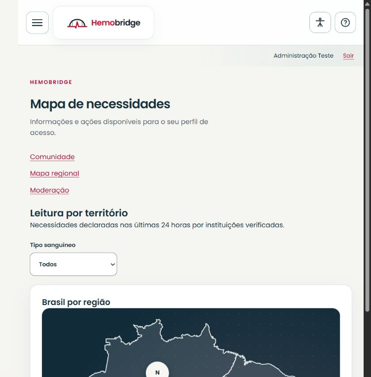
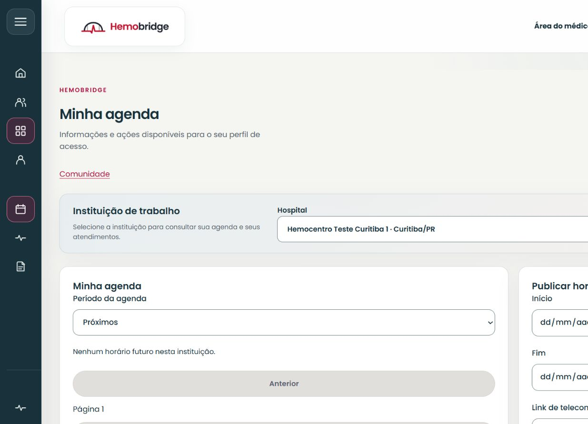

# Conferência web em celular, tablet e desktop

Execução em 21/10/2026; consolidação em 22/10. Executor: Codex, por controles visíveis no navegador real do notebook. Código `1b64f929`, depois da reconciliação com a main. API local com PostgreSQL e registros exclusivos de teste; nenhuma redefinição da carga existente. Não foram utilizados dados de pacientes atendidos.

## Resultado observado

Foram registradas **47 combinações de página/resolução**, com captura da tela, leitura da largura do documento e verificação do foco. Em todas, a largura rolável do documento foi igual à largura interna disponível: **nenhuma rolagem horizontal foi observada**. A diferença de 15 px em parte das medições corresponde à barra de rolagem vertical do navegador.

As dimensões foram 360 × 800, 768 × 1024 e 1440 × 900 px. O painel do paciente foi capturado em 360 e 1440; as outras quinze páginas abaixo foram capturadas nas três dimensões. Os [arquivos e medidas](evidencias/responsividade-2026-10-21/medidas.json) identificam cada captura e seu hash. A extensão JPEG/PNG acompanha a assinatura real retornada pelo navegador.

| Perfil/contexto | Páginas verificadas |
| --- | --- |
| Visitante | Início e pré-cadastro, sem enviar cadastro ou aceitar termos |
| Paciente/Doador | Painel, perfil, locais, comunidade e comentários |
| Doador aprovado | Painel com situação e tipagem validadas da carga de testes |
| Médico | Agenda, atendimento e exames atribuídos |
| Representante de Hospital | Necessidades e estoque |
| Administrador | Mapa regional, moderação e solicitações de privacidade |

Os cinco cenários de conta foram acessados com as credenciais de testes documentadas. O menu móvel abriu, recebeu foco no primeiro destino e recolheu ao navegar. No desktop, a navegação lateral permaneceu disponível. Após a mudança de rota, o foco observado ficou no título principal; na entrada direta dos comentários, no título da seção de comentários. Isso é uma verificação pontual, não uma certificação integral de acessibilidade ou de todas as combinações de teclado/leitor de tela.

Em Locais, a seleção de Paraná carregou seus municípios e permitiu selecionar Curitiba. Na comunidade, foram abertos comentários existentes e utilizado o retorno à lista. O contexto administrativo continuou disponível no menu após esse retorno. Não foram publicados conteúdos, alteradas necessidades, registradas bolsas nem realizadas decisões clínicas durante esta conferência.

## Capturas representativas

Fonte: aplicação HemoBridge executada localmente, 21 out. 2026; conta sintética de testes.

Fonte: aplicação HemoBridge executada localmente, 21 out. 2026. O estado vazio reflete ausência de informação atualizada na seleção, sem inferir estoque nacional.

Fonte: aplicação HemoBridge executada localmente, 21 out. 2026; instituição e conta sintéticas de testes.

## Alcance para PT23

O resultado técnico da apresentação e da navegação exercitadas foi aprovado. Constitui evidência real de web em celular, tablet e desktop, complementando os testes de lógica/widget. **Não atribui aceite humano integral ao PT23.** Não foram enviados todos os formulários nem percorridos todos os estados de erro, dados, modal e tabelas extensas em cada dimensão.

Os controles de login, menus, seleção IBGE e leitura/retorno de comentários foram exercitados. A coleta de imagens não comprova edição, publicação, upload, geração de PDF, abertura de Maps/teleconsulta ou uso de GPS. Não é homologação física do aplicativo Flutter. A rodada no Android corrigido continua pendente da conexão do aparelho.
