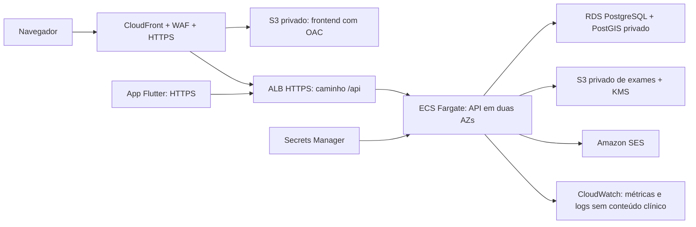

# Produção na AWS

Este plano substitui a dependência operacional da máquina do laboratório. A VM recebida é um ambiente de desenvolvimento com PostgreSQL, SeaweedFS e Mailpit; seu ciclo de vida acompanha o laboratório. Código, migrações e backups são artefatos distintos. O bundle recebido contém 15 commits posteriores à base integrada e foi incorporado preservando a autoria. A chave SSH permanece fora do projeto.

## Arquitetura

O frontend usa `/api`. O CloudFront encaminha esse caminho ao ALB sem cache e preserva cookies e cabeçalhos de autenticação. No ambiente AWS, `API_PREFIX=api` faz o Nest atender os mesmos caminhos. O aplicativo usa a URL HTTPS pública da API definida em `--dart-define=API_URL=...`; ele mantém o token no armazenamento seguro do sistema operacional.

## Provisionamento

| Recurso | Configuração de produção |
|---|---|
| Região | `sa-east-1` como configuração inicial; confirmar disponibilidade e orçamento na conta que operará o serviço |
| Rede | VPC própria, duas zonas de disponibilidade, sub-redes públicas para ALB/NAT, privadas para Fargate e isoladas para RDS |
| RDS | PostgreSQL com versão compatível com PostGIS, Multi-AZ, `PubliclyAccessible=false`, armazenamento e backups cifrados por KMS, proteção contra exclusão, backups automáticos por 35 dias |
| Acesso ao banco | Porta 5432 aceita somente o grupo de segurança da API e da tarefa de migração; conexão TLS com verificação completa do certificado do RDS |
| API | Imagem Docker no ECR, execução Fargate sem IP público, usuário não root, filesystem somente leitura, logs enviados ao CloudWatch |
| Escala | Mínimo de 2 e máximo inicial de 8 tarefas; alvos de CPU 60% e memória 70%; expansão em 60 s, redução em 180 s; ajustar por teste de carga |
| ALB | HTTPS com certificado ACM; HTTP redireciona para HTTPS; health check `/api/health/ready`; a aplicação expõe também `/api/health/live` |
| Frontend | Bucket S3 com bloqueio de acesso público e OAC exclusivo do CloudFront; arquivos com hash recebem cache longo, HTML exige revalidação |
| Exames | Bucket separado, privado, acesso restrito à task role, SSE-KMS, TLS obrigatório, versão de objetos e política de retenção por categoria de registro |
| E-mail | SES com domínio verificado, DKIM/SPF/DMARC e saída do sandbox; mensagens não incluem exames, CPF, diagnósticos ou o conteúdo clínico de consultas |
| Segredos | Secrets Manager para conexão do usuário de aplicação, JWT, chave de cifra dos arquivos e SMTP; nenhum segredo vai para imagens, Git, frontend ou ZIP |
| Observabilidade | Alarmes de 5xx, latência, falha de health check, CPU/memória, conexões RDS, espaço livre, falha de backup e indisponibilidade de envio de e-mail |

A criptografia em repouso do RDS cobre também logs, backups e snapshots. A API deve usar um usuário de banco com permissões de aplicação, separado do proprietário que executa migrações. O segredo de administrador gerenciado pelo RDS nunca é entregue à task role normal. O certificado CA é incluído no Dockerfile; use `sslmode=verify-full&sslrootcert=/app/certs/rds-ca.pem` na conexão e teste a rotação do certificado.

Referências: [criptografia do RDS](https://docs.aws.amazon.com/AmazonRDS/latest/UserGuide/Overview.Encryption.html), [TLS com PostgreSQL no RDS](https://docs.aws.amazon.com/us_en/AmazonRDS/latest/UserGuide/PostgreSQL.Concepts.General.SSL.html), [RDS em VPC](https://docs.aws.amazon.com/AmazonRDS/latest/UserGuide/USER_VPC.WorkingWithRDSInstanceinaVPC.html), [segurança no Fargate](https://docs.aws.amazon.com/AmazonECS/latest/developerguide/security-fargate.html).

## Autenticação e privacidade

- As contas e os perfis são carregados do banco a cada requisição. Alterar um perfil na interface não concede permissão. Desativação e versão de sessão são verificadas pelo guard.
- Senhas usam Argon2, comparação de duração equivalente para usuário inexistente, bloqueio por tentativas e limitação de requisições. Tokens têm expiração curta; configure `JWT_EXPIRACAO=15m`, emissor e audiência exclusivos do ambiente.
- A sessão web usa cookie `HttpOnly`, `Secure` e `SameSite=Lax`. Requisições que alteram dados com esse cookie exigem `Origin` permitido. O JavaScript não recebe o token da rota de sessão web. O app utiliza Bearer e armazenamento seguro, sem guardar dados clínicos em preferências locais.
- Profissionais recebem acesso ao hospital e aos atendimentos autorizados. O vínculo com múltiplas instituições não libera acesso geral à base. Administradores recebem agregados e funções administrativas, sem conteúdo de exames nos indicadores.
- O aceite de finalidade, versão do termo e data é persistido. Pedidos de exclusão são registrados e atendidos conforme a categoria de dado e a obrigação de guarda. O encerramento não apaga automaticamente registros clínicos.
- Exames passam por limites de tamanho e validação de formato. O banco guarda metadados e hash; os arquivos são cifrados na aplicação e no S3. Chave de aplicação e chave KMS têm ciclo de rotação documentado e acesso separado. Preserve a chave antiga durante uma migração de cifra; não a substitua antes de recifrar e verificar todos os objetos.
- Auditoria registra ação, identificador da entidade e autoria, sem senha, token ou conteúdo do exame. Movimentos de estoque são imutáveis. Não habilite log de corpos HTTP ou de consultas com parâmetros de saúde.
- Adote MFA para acessos administrativos da AWS e para a operação institucional; não compartilhe contas. Se o provedor de identidade for substituído por Cognito, mantenha o vínculo do identificador externo com o usuário interno e continue autorizando cada ação pelo banco, sem confiar em papel enviado pelo cliente.

A [LGPD](https://www.planalto.gov.br/ccivil_03/_ato2015-2018/2018/lei/l13709.htm) exige que o operador defina finalidade, base legal, agentes, canal de direitos e medidas de segurança. A implantação técnica não substitui essa atribuição jurídica. `VITE_LEGAL_ENTITY_NAME` e `VITE_PRIVACY_CONTACT` são obrigatórios no comando de build para publicação.

## Sequência de entrega

1. Criar conta/ambientes separados, política de acesso, MFA, orçamento e alarmes de custo. Definir domínio e certificados ACM; criar inventário dos dados e registros de tratamento.
2. Provisionar rede, KMS, buckets, ECR, Secrets Manager e RDS. Instalar extensões `postgis`, `unaccent` e `btree_gist` com o usuário de migração. Aplicar a cadeia Prisma em uma tarefa ECS isolada, com imagem `migrations` e segredo próprio.
3. Executar somente o seed de referência e do administrador inicial. O seed de testes é bloqueado em produção. Validar a troca da senha inicial e as permissões do usuário de aplicação antes de abrir tráfego.
4. Publicar a imagem de runtime por digest, registrar a task definition, ligar o serviço ao target group e configurar autoscaling. O circuit breaker deve reverter uma implantação que não fique saudável.
5. Gerar o frontend com identidade jurídica e canal válidos, enviar os arquivos ao S3 e configurar CloudFront/OAC/WAF. Cache de `/api/*` deve ser desabilitado; respostas autenticadas e arquivos clínicos usam `Cache-Control: no-store`.
6. Testar em homologação todos os perfis, concorrência de agendamento/estoque, sessão expirada, origem inválida, autorização por instituição, envio/download de exame, recuperação de senha, acessibilidade e restauração de backup.
7. Exportar separadamente o banco e os objetos que realmente precisam migrar da VM. Validar integridade, autoria e finalidade antes da importação. Não importar contas ou hospitais da massa de testes para produção. Registrar hash dos arquivos e fazer uma restauração de ensaio.
8. Fazer corte com janela controlada, tráfego gradual, alarmes acompanhados e rollback para a imagem anterior. Mudanças de banco seguem o padrão expandir/migrar/contrair; evite remover colunas no mesmo deploy em que o código antigo ainda está ativo.

Os arquivos de task definition são templates de configuração; não provisionam recursos nem geram custo sozinhos. Para acesso operacional ao ambiente privado, prefira sessões SSM ou tarefas de manutenção com identidade individual, evitando uma chave SSH compartilhada.

## Recuperação e publicação

Meta inicial de operação: RPO de 24 horas e RTO de 4 horas, sujeitos à validação por restauração. Backups do RDS e versões dos objetos devem ser testados em um ambiente isolado. Copiar backups entre regiões só deve ocorrer conforme a política de localização e transferência dos dados. A política de retenção distingue preferências de navegação, dados da conta, auditoria, arquivos de exame e registros clínicos.

Antes da publicação, registrar: responsável jurídico e canal de privacidade reais; domínio e certificados; conta/região AWS; segredos próprios; restauração aprovada; teste de carga concorrente; validação dos fluxos clínicos e revisão do código. No iOS são necessários macOS/Xcode, assinatura e conta de distribuição. No Android, a chave de assinatura fica fora do repositório. Nenhuma destas credenciais acompanha o pacote de código.

A API também exige LEGAL_ENTITY_NAME e PRIVACY_CONTACT no ambiente de produção. Esses valores devem coincidir com a identificação publicada no site e no aplicativo. O controle de requisições na borda deve ser compartilhado pelo WAF; o limite em memória da API funciona por tarefa e não substitui esse controle ao escalar horizontalmente.
